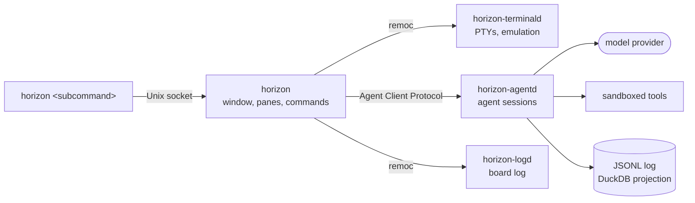

# Horizon

**A native workspace for terminals and AI agents, built on Blitz.**

Horizon is a tabbed, split-pane desktop application in Rust. Terminals
and agents are sessions hosted by daemons; the window is a client that
shows them in panes and can come and go without ending them.

<!-- screenshot: a tab split three ways — a terminal, an agent mid-turn, the board -->

## Architecture



- **The window holds no session.** It draws frames a daemon sends and
  sends input back. Closing a pane detaches; quitting leaves the daemons
  running; the next start restores the layout around live sessions.
- **Each daemon reloads alone.** A new agent runtime is picked up without
  touching a single PTY.
- **One command model.** Key bindings, the palette and the CLI all execute
  the same commands, so an agent in a pane operates the workspace through
  `horizon <subcommand>` exactly as a person does through keys.
- **The agent runtime does not need this window.** It speaks ACP, keeps
  its own log, and is a crate of its own.

## What it does

| | |
| --- | --- |
| **Workspace** | tabs, nested weighted splits, a modal key layer behind one chord (`ctrl+'`), command palette, layout restore |
| **Sessions** | detach and attach, a session manager showing which session started which, explicit terminate |
| **Terminal** | Kitty keyboard protocol, IME, scrollback, selection, box and block characters painted as shapes |
| **Agent** | OpenAI-compatible and Anthropic providers, roles and skills, shell / file / web / worktree tools, recall over past sessions |
| **Safety** | Landlock sandbox with a network allowlist proxy, three-tier approval, per-project grants |
| **CLI** | create, attach, message, approve and inspect sessions from a shell or from an agent |
| **Views** | task board, Markdown, project wiki, file finder, theme settings |
| **Extensions** | views as wasm components; live preview of a view under development |

## Stack

| Layer | Crates |
| --- | --- |
| Rendering | [Blitz](https://github.com/DioxusLabs/blitz) `0.3.0-beta` — Stylo, Taffy, Parley, Vello — on winit |
| Reactivity | `reactive_graph` |
| Styling | CSS modules checked at compile time with `lightningcss` |
| Terminal | `alacritty_terminal`, `termwiz`, `portable-pty` |
| Agent protocol | `agent-client-protocol` |
| Providers | `rig-core`, `reqwest` (rustls) |
| Storage | JSONL event logs, [DuckDB](https://duckdb.org) 2.0 |
| IPC | `remoc`, Unix sockets |
| Sandbox | `nono` (Landlock / Seatbelt), `hudsucker` |
| Plugins | `wasmtime`, WASI preview 2 components |
| Text | `markdown`, `pulldown-cmark`, `nucleo` |
| Runtime | `tokio` |

## Workspace layout

| Crate | |
| --- | --- |
| `horizon` (root) | the window: views and their wiring |
| `horizon-ui`, `horizon-ui-macros` | what a view is built with; the only code that names Blitz's document |
| `horizon-theme`, `horizon-theme-css` | the color scheme derived from a seed; the theme as CSS variables |
| `horizon-workspace` | tabs, panes, the layout tree, the command model |
| `horizon-shell-runtime` | clients of the daemons, with no UI framework in them |
| `horizon-terminal-core`, `horizon-terminald` | emulation and the session loop; the daemon that owns PTYs |
| `horizon-agent`, `horizon-agentd` | providers, tools, persistence; the daemon that hosts them |
| `horizon-acp` | Horizon's extensions to ACP |
| `horizon-sandbox`, `-runtime`, `-proxy` | containment for agent commands |
| `horizon-board`, `horizon-board-view`, `horizon-logd` | the board's event store, view logic, and log daemon |
| `horizon-control`, `horizon-cli` | the control-plane contract and its client |
| `horizon-wire` | codec, versioning and socket conventions under every daemon's wire |
| `horizon-config` | the one loader of `config.toml` |
| `horizon-wiki` | the project wiki's pages and comments |
| `plugins/markdown`, `preview-plugin` | wasm components |

## Build

```sh
scripts/install-duckdb-prefix.sh   # DuckDB 2.0 into ~/opt/duckdb, no root
cargo build --workspace            # the window and all daemons
./target/debug/horizon             # then ctrl+' and :
```

Linux is the daily platform; the current renderer has not been run on
macOS. There are no releases. "Build setup" in [`AGENTS.md`](AGENTS.md)
has the Cargo configuration DuckDB needs, and
[`config.example.toml`](config.example.toml) documents every setting,
including providers and models for agents.

## Further reading

- [`docs/roadmap.md`](docs/roadmap.md) — current position and open work
- [`docs/ui-foundation-migration-design.md`](docs/ui-foundation-migration-design.md) — why Blitz
- [`docs/acp-agentd-design.md`](docs/acp-agentd-design.md),
  [`docs/terminald-split-design.md`](docs/terminald-split-design.md) — the daemons
- [`docs/agent-approval-design.md`](docs/agent-approval-design.md),
  [`docs/sandbox-perimeter-design.md`](docs/sandbox-perimeter-design.md) — approval and containment
- [`AGENTS.md`](AGENTS.md) — conventions and the quality gate
